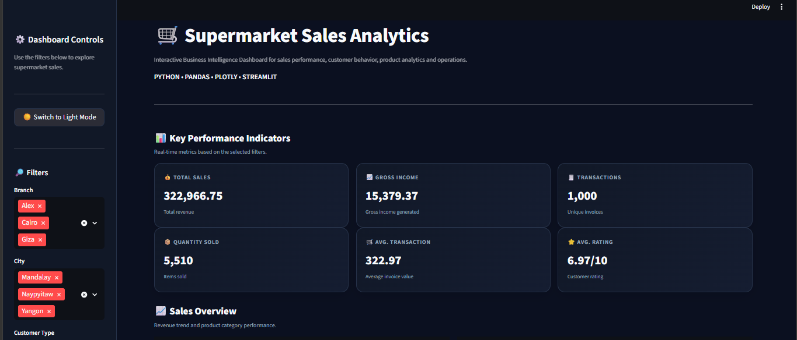
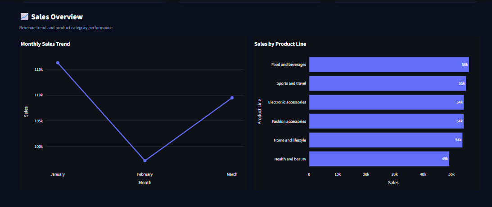
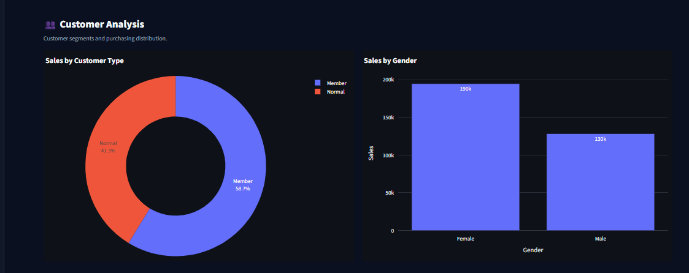

# 🛒 Supermarket Sales Analytics

An interactive Business Intelligence dashboard for analyzing supermarket sales, customer behavior, product performance, payment methods, time-based sales patterns, and branch performance.

## 📊 Project Overview

This project analyzes supermarket transaction data containing 1,000 sales records across different branches, cities, product categories, customer segments, genders, and payment methods.

The project follows an end-to-end data analytics workflow:

**Raw Data → Data Cleaning → Exploratory Data Analysis → Feature Engineering → SQL Analysis → Interactive Dashboard → Business Insights**

## 🚀 Dashboard Features

- 📊 Interactive KPI dashboard
- 🔎 Dynamic filters
- 💰 Total sales analysis
- 📈 Monthly sales trends
- 🛍️ Product category performance
- 👥 Customer type analysis
- 🚻 Gender-based sales analysis
- 💳 Payment method analysis
- ⏰ Time-period analysis
- 🏪 Branch performance comparison
- 💡 Automated business insights
- 📋 Filtered transaction data

## 📌 Key Performance Indicators

The dashboard provides:

- Total Sales
- Gross Income
- Number of Transactions
- Quantity Sold
- Average Transaction Value
- Average Customer Rating

## 🛠️ Tech Stack

- **Python**
- **Pandas**
- **NumPy**
- **Matplotlib**
- **Seaborn**
- **Plotly**
- **Streamlit**
- **SQL**
- **SQLite**
- **Jupyter Notebook**
- **Git & GitHub**

## 📂 Project Structure

```text
Supermarket-Sales-Analytics/
│
├── data/
│   └── SuperMarket Analysis.csv
│
├── notebooks/
│   └── Supermarket Sales Analysis.ipynb
│
├── sql/
│   └── analysis_queries.sql
│
├── dashboard/
│   └── app.py
│
├── images/
│   ├── dashboard_overview.png
│   ├── sales_overview.png
│   └── customer_analysis.png
│
├── README.md
├── requirements.txt
└── .gitignore
```

## 📸 Dashboard Preview

### Dashboard Overview



### Sales Overview



### Customer Analysis



## 🔍 Data Analysis

### Sales Analysis

The project analyzes:

- Monthly revenue trends
- Product category sales
- Branch-level performance
- Average transaction value

### Customer Analysis

The dashboard explores:

- Member vs Normal customers
- Gender-based sales distribution
- Customer purchasing behavior
- Average customer ratings

### Operations Analysis

The project analyzes:

- Cash transactions
- Credit card transactions
- E-wallet transactions
- Morning, Afternoon, Evening and Night sales patterns

## 🧹 Data Cleaning

The dataset was checked and prepared using Python and Pandas.

The preprocessing workflow included:

- Column name standardization
- Date conversion
- Time conversion
- Missing-value validation
- Duplicate-value validation
- Numerical data validation
- Sales calculation validation
- Feature engineering

Additional analytical features were created, including:

- Month
- Month Name
- Day
- Day Name
- Hour
- Time Period
- Revenue per Item

## 🗄️ SQL Analysis

SQLite was used to perform analytical queries for:

- Product-line performance
- Branch and city performance
- Customer segmentation
- Monthly sales
- Payment methods
- Time-period performance

SQL queries are available in:

```text
sql/analysis_queries.sql
```

## 💡 Business Insights

The dashboard dynamically identifies observations from the selected dataset and filters, including:

- Leading product category
- Highest-sales branch
- Leading customer segment
- Leading payment method
- Highest-sales time period

## ▶️ How to Run the Project

### 1. Clone the repository

```bash
git clone YOUR_GITHUB_REPOSITORY_URL
```

### 2. Open the project folder

```bash
cd Supermarket-Sales-Analytics
```

### 3. Install dependencies

```bash
pip install -r requirements.txt
```

### 4. Run the Streamlit dashboard

```bash
cd dashboard
streamlit run app.py
```

The dashboard will open in your browser.

## 📊 Dataset

The dataset contains supermarket transaction records with information such as:

- Invoice ID
- Branch
- City
- Customer Type
- Gender
- Product Line
- Unit Price
- Quantity
- Tax
- Sales
- Date
- Time
- Payment Method
- Cost of Goods Sold
- Gross Income
- Customer Rating

## 🎯 Project Objective

The objective of this project is to demonstrate practical skills in:

- Data cleaning
- Exploratory Data Analysis
- Data visualization
- SQL analytics
- Business intelligence
- Interactive dashboard development
- Business insight generation

## 👩‍💻 Author

**Sweti Yadav**

B.Tech CSE – Artificial Intelligence & Machine Learning

Kolkata, India